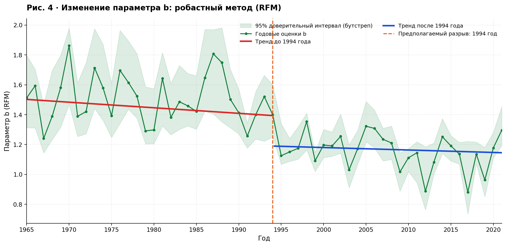
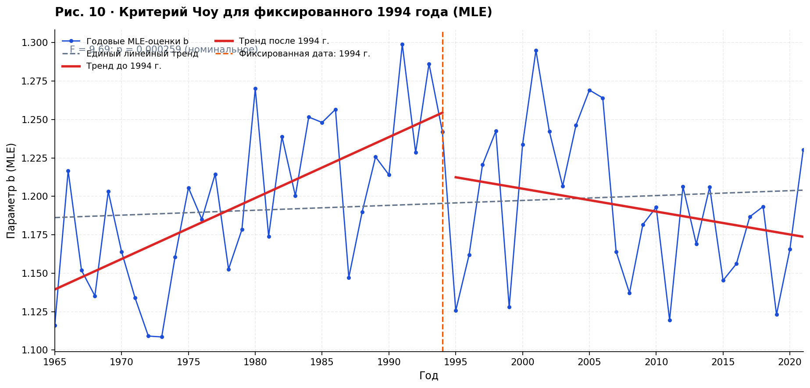

# Долговременная изменчивость параметра b закона Гутенберга–Рихтера

**Воспроизводимый анализ глобальной сейсмичности за 1965–2021 годы**  
RFM · MLE · supF · критерий Чоу · b-positive · каталоги ISC и NEIC

Проект сопровождает статью М. Р. Хакимовой и А. Б. Дерендяева «Долговременная изменчивость параметра b закона Гутенберга–Рихтера: статистическая значимость структурных изменений и чувствительность к методам оценивания» (*Информационные процессы*, 2026, том 26, № 1).

Здесь оставлены **только окончательные вычисления и одиннадцать рисунков статьи**. Черновые эксперименты, тысячи промежуточных изображений и повторяющиеся скрипты из рабочего архива не включены.

## Быстрый запуск

Требуется **Python 3.10 или новее**. Нужна установка библиотек только один раз:

```bash
python -m pip install -r requirements.txt
python run.py
```

После выполнения:

- `figures/` содержит все **11 рисунков** с русскими заголовками, осями и легендами;
- `results/rfm_годовые_оценки.csv` содержит годовые `Mc`, `a`, `b` и доверительные интервалы;
- `results/mle_годовые_оценки.csv` содержит оценки MLE при `M0 = 5.0`, `5.5`, `6.0`;
- `results/ИТОГИ_АНАЛИЗА.md` содержит результаты проверок и ограничения их интерпретации.

Для повторного построения по уже сохранённым годовым результатам:

```bash
python run.py --quick
```

Для увеличения числа бутстреп-повторов при проверке RFM:

```bash
python run.py --n-boot 19999
```

**Ничего скачивать и настраивать в PostgreSQL для этих команд не нужно.** Два подготовленных каталога сжаты и включены в `data/`.

## Состав репозитория

```text
Gutenberg_Richter_GitHub/
├── README.md                  # Как работать с проектом
├── РИСУНКИ.md                # Пояснения ко всем 11 рисункам
├── run.py                     # Один запуск: расчёты, тесты и графики
├── loader.py                  # Загрузчик ISC, сохранён и очищен от секретов
├── postgres.py                # Необязательное подключение к базе через окружение
├── requirements.txt           # Библиотеки Python
├── .env.example               # Образец настроек для необязательной БД
├── .gitignore                 # Исключения для Git
├── src/
│   ├── config.py              # Настройки и единое оформление
│   ├── rfm.py                 # RFM: расчёт a, b, Mc
│   ├── mle.py                 # MLE Аки для трёх магнитудных порогов
│   ├── bpositive.py           # b-positive по последовательным магнитудам
│   ├── statistics.py          # Критерий Чоу, supF, поправка Холма
│   └── plots.py               # Рисунки 1–11
├── data/                      # Исходные данные и компактные годовые итоги
├── figures/                   # Готовые русскоязычные изображения
├── results/                   # Годовые таблицы и статистический отчёт
└── tests/                     # Проверки корректности расчётов
```

## Основные результаты

| Метод | Характеристика | Полученный результат |
|---|---|---:|
| RFM + supF | Наиболее вероятная дата | **1994** |
| RFM + supF | Максимальное F | **6,90** |
| RFM + supF | p (Wild-Block Bootstrap, 1999 повторов) | **0,0485** |
| MLE при M0 = 5,0 | F критерия Чоу | **9,6878** |
| MLE при M0 = 5,0 | Номинальное p | **0,000259** |
| MLE при M0 = 5,5 | Номинальное p | **0,00434** |
| MLE при M0 = 6,0 | Номинальное p | **0,0190** |

Максимум supF для RFM приходится на 1994 год, но его значимость **пограничная**. Дата для MLE была выбрана на этапе RFM по связанным данным, поэтому проверка Чоу **не является полностью независимой**. Региональный b-positive не дал сопоставимого устойчивого подтверждения после учёта множественных сравнений. Статистический разрыв не следует автоматически считать физическим изменением глобального сейсмического режима.

## Рисунки

Краткие описания каждого рисунка находятся в [**РИСУНКИ.md**](РИСУНКИ.md). Изображения сохранены в PNG и готовы для вставки в статью.

| № | Рисунок | Раздел |
|---|---|---|
| 1 | [Частотно-магнитудное распределение](figures/01_частотно_магнитудное_распределение.png) | Закон Гутенберга–Рихтера |
| 2 | [Изменение Mc](figures/02_магнитуда_полноты_mc.png) | Полнота каталога |
| 3 | [Изменение параметра a](figures/03_параметр_a.png) | Сейсмическая активность |
| 4 | [Временная динамика b (RFM)](figures/04_динамика_b_rfm.png) | Робастное оценивание |
| 5 | [Зависимость F от предполагаемой даты](figures/05_тест_supf.png) | supF-тест |
| 6 | [NEIC: медианы b-positive](figures/06_bpositive_neic_медиана.png) | Чувствительность к порогам |
| 7 | [NEIC: взвешенные средние b-positive](figures/07_bpositive_neic_взвешенное.png) | Чувствительность к порогам |
| 8 | [ISC Mw: медиана и взвешенное среднее](figures/08_bpositive_isc_mw.png) | Сравнение каталогов |
| 9 | [Динамика b (MLE)](figures/09_динамика_b_mle.png) | Максимальное правдоподобие |
| 10 | [MLE: критерий Чоу для 1994 года](figures/10_критерий_чоу_mle.png) | Проверка даты |
| 11 | [MLE: три порога M0](figures/11_mle_разные_пороги.png) | Чувствительность результатов |

### Предпросмотр ключевых результатов





## Исходные данные и воспроизводимость

**ISC Bulletin (гомогенизированные Mw)** — глобальная таблица, полученная в исходном эксперименте из `master_mw_catalog`; лежит в `data/isc_mw_1960_2021.csv.gz`. Внутри исходного архива она называлась `NEIC_Mw_1965_2021_M3.5_with_FE.csv`, но скрипт её формирования (`experiment_28/fe.py`) выбирал данные **из ISC/гомогенизированного каталога**, а не из NEIC. Имя исправлено для ясности. В этой таблице есть годы до 1965; расчёты RFM/MLE ограничены периодом статьи.

**NEIC (магнитуды mb)** — файл `data/neic_mb_1973_2021.csv.gz`, полученный из исходного `NEIC_mb_1965_2021_M3.5_with_FE.csv`. Имеющиеся в архиве записи начинаются в 1973 году. Поэтому региональные графики NEIC построены за 1973–2021 годы, а не за отсутствующий в исходном файле период 1965–1972.

**Готовые региональные b-positive** — `data/bpositive_neic_итоги.csv` и `data/bpositive_isc_итоги.csv`. Это годовые медианы и взвешенные средние из **финальных результатов, находившихся в предоставленном архиве**. Их публикационные графики строятся непосредственно из этих сохранённых результатов; заново все региональные доверительные интервалы и статистические тесты в стандартном запуске не пересчитываются. Реализация самого оценивателя находится в `src/bpositive.py`.

**RFM доверительные интервалы** — `data/rfm_доверительные_интервалы.csv` из файла `latex_supf_b_data.txt` исходного эксперимента. Значения `Mc`, `a`, `b` рассчитываются заново из сжатого ISC-каталога, а доверительные интервалы используются готовые, как в статье.

**GOR-гомогенизация** — исходные магнитуды уже преобразованы в Mw до создания включённого каталога. Исходные пары магнитуд, параметры отношения дисперсий и полная процедура получения коэффициентов GOR в папке не представлены; поэтому этот этап нельзя независимо восстановить только по данной поставке. Код не делает вид, что повторно выполнил GOR.

**Замечание по b-positive:** в тексте статьи указан порог разности 0,2, но в рабочих скриптах архива для некоторых вариантов с референсной магнитудой `M ≥ 4,0` использован порог разности 0,1. Для рисунков 6–8 взяты сохранённые результаты архива, без подмены их другими вычислениями. В `src/bpositive.py` порог можно явно задать параметром `difference_threshold`.

Источники: [бюллетень ISC](https://www.isc.ac.uk/iscbulletin/), каталоги NEIC/USGS; метод b-positive — van der Elst (2021). При публикации данных и графиков сохраняйте соответствующие ссылки на первоисточники и статью.

## О загрузчике и безопасности

Файлы `loader.py` и `postgres.py` сохранены **под теми же именами**, что в прежнем GitHub-репозитории, но очищены от жёстко прописанных адресов и паролей. Загрузчик предназначен для скачивания QuakeML за **небольшие интервалы** (без GOR-конвертации):

```bash
python loader.py --start 2020-01-01 --end 2020-01-02 --out downloads
```

PostgreSQL для основной работы не требуется. При необходимости используйте переменную окружения `EARTHQUAKE_DB_URL`, ориентируясь на `.env.example`; локальный `.env` уже исключён из Git. Для соединения с PostgreSQL дополнительно установите `psycopg2-binary` (или соответствующий драйвер SQLAlchemy). Для записи геоданных PostGIS потребуется `geopandas`.

**Важно:** в старой публичной версии репозитория параметры подключения находились непосредственно в исходниках. После замены файлов желательно сменить ранее использовавшийся пароль базы: перезапись Git-файлов не удаляет данные из истории старых коммитов.

## Как обновить существующий GitHub-репозиторий

1. Откройте [effectOfNEonABvalues](https://github.com/MavjudaHakimova/effectOfNEonABvalues) или локальную копию репозитория.
2. **Замените содержимое корня** файлами из этой папки (старые `RFM_final.py`, `RFM_minmc.py`, `lines_with_chow_*.py`, старые картинки и `.DS_Store` для итоговой структуры не нужны). Не удаляйте скрытую папку `.git`, если работаете в существующей локальной копии.
3. Сделайте обычный коммит и отправьте изменения:

```bash
git add -A
git commit -m "Оформить воспроизводимый анализ для статьи"
git push origin master
```

Если основная ветка у вас называется `main`, используйте вместо `master` название `main`.

Для проверки корректности расчётов перед публикацией:

```bash
python -m unittest discover -s tests -v
```
