# Описание рисунков

Все изображения соответствуют нумерации статьи и подписаны **по-русски**. Файлы PNG лежат в папке `figures/`. Ниже — пояснения к осям, линиям и научной интерпретации.

### Рисунок 1. Частотно-магнитудное распределение за 1965 год

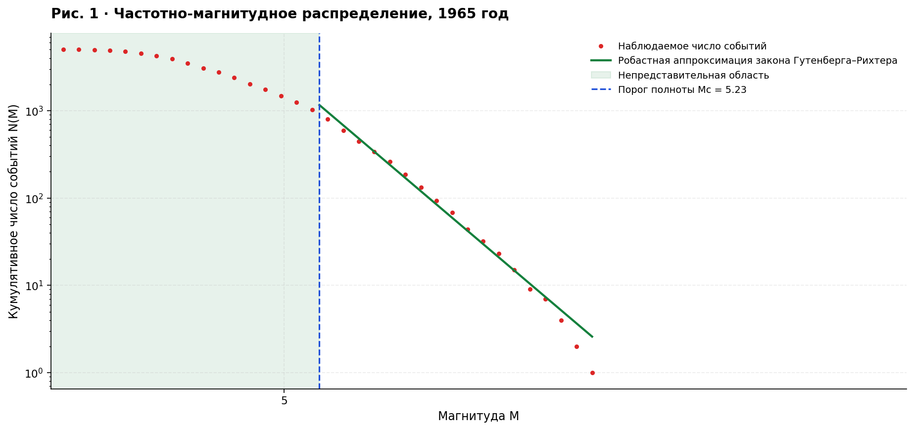

Красные точки — наблюдаемое кумулятивное число землетрясений с магнитудой не ниже M. Зелёная линия — RFM-аппроксимация закона Гутенберга–Рихтера. Синяя пунктирная вертикаль показывает магнитуду полноты Mc; закрашенная область левее Mc указывает на часть распределения, где каталог может быть неполон.

### Рисунок 2. Временная динамика магнитуды полноты Mc

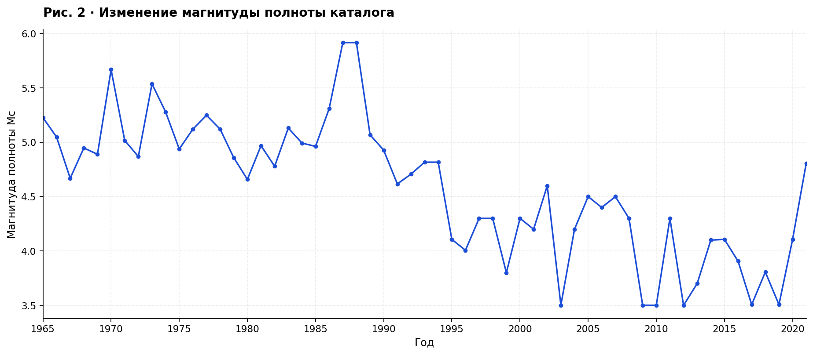

Синяя линия соединяет годовые оценки Mc за 1965–2021 годы. Изменение полноты регистрации существенно влияет на состав событий, участвующих в оценивании b.

### Рисунок 3. Динамика параметра a

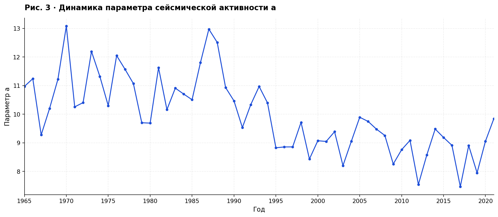

Показаны годовые оценки параметра a закона Гутенберга–Рихтера, отражающего общий уровень частоты зарегистрированных событий. Колебания следует рассматривать в контексте полноты и состава каталога.

### Рисунок 4. Динамика b (RFM) и предполагаемое изменение 1994 года

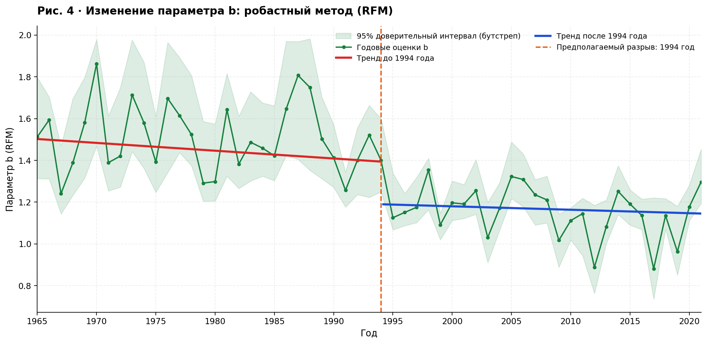

Зелёная линия и маркеры — годовые оценки b, светло-зелёная область — 95% бутстреп-доверительные интервалы, красная линия — линейный тренд до 1994 года, синяя — после 1994 года. Оранжевая вертикаль показывает оптимальный год структурного изменения по supF-тесту.

### Рисунок 5. Кривая F-статистики при переборе даты изменения

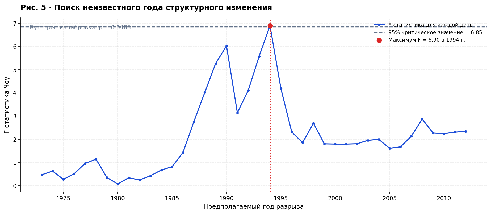

Синяя кривая показывает статистику Чоу для каждой допустимой даты разрыва; красная метка — максимум в 1994 году, серая горизонтальная пунктирная линия — 95% критическое значение бутстреп-распределения. Значимость **пограничная**: p около 0,0485.

### Рисунок 6. Региональные медианы b-positive по NEIC (mb)

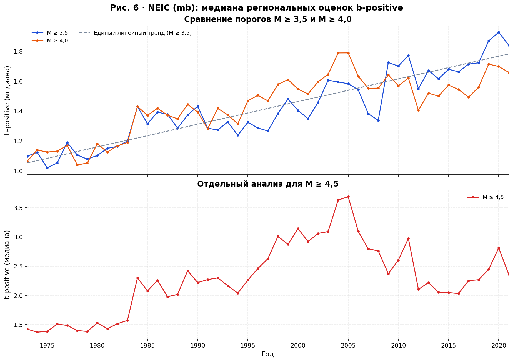

Верхняя панель сопоставляет медианные региональные b-positive при нижних порогах M ≥ 3,5 и M ≥ 4,0; нижняя — отдельный ряд для M ≥ 4,5. Серый пунктир — единый линейный тренд ряда M ≥ 3,5. При повышении порога возрастают оценки b-positive; интерпретация осложняется насыщением шкалы mb.

### Рисунок 7. Региональные взвешенные средние b-positive по NEIC (mb)

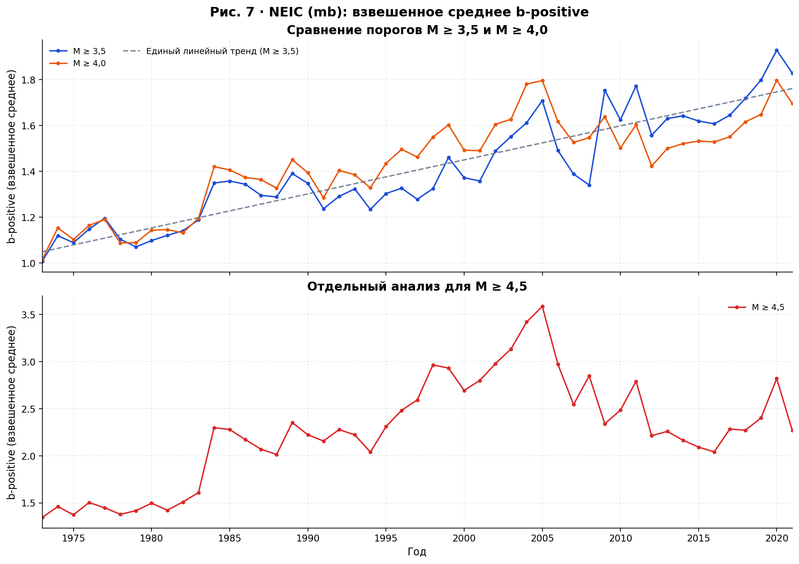

Аналогичное сравнение порогов, но с агрегированием регионов по числу использованных положительных магнитудных разностей. Более сейсмоактивные области получают больший вес.

### Рисунок 8. Сравнение b-positive по гомогенизированному ISC (Mw)

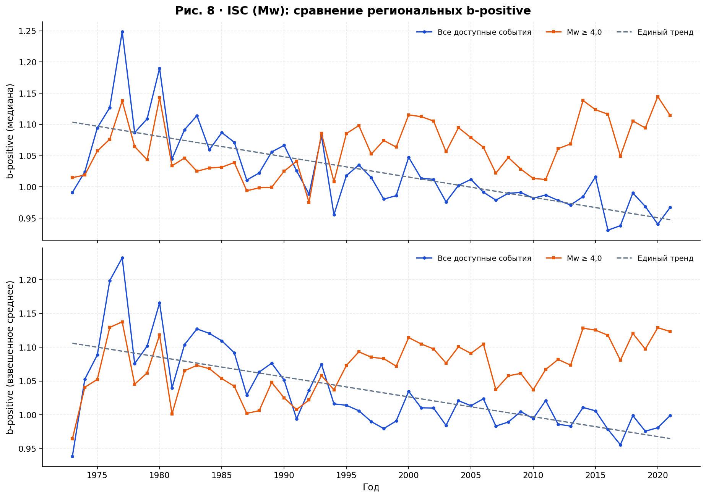

Верхняя панель — региональные медианы, нижняя — взвешенные средние. Синим показаны все доступные события, оранжевым — события Mw ≥ 4,0; серым пунктиром — единый тренд для первого ряда. Поведение оценок отличается от NEIC mb, что подчёркивает роль магнитудной шкалы и регистрации.

### Рисунок 9. Временная динамика b по MLE

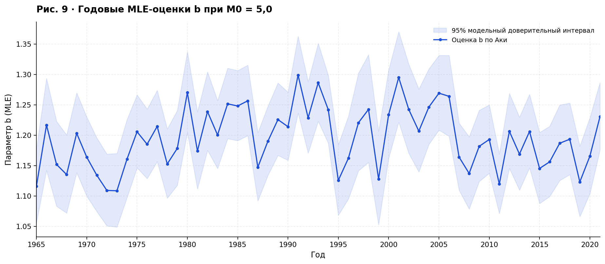

Синяя линия — годовые оценки b методом максимального правдоподобия Аки для фиксированного порога M0 = 5,0. Полупрозрачная область — 95% модельный доверительный интервал (не учитывает систематические ошибки каталога).

### Рисунок 10. Критерий Чоу для фиксированного 1994 года (MLE)

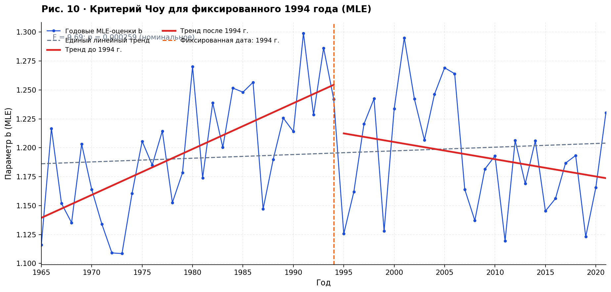

Синие точки и линия — годовые оценки b, серый пунктир — единый тренд, красные прямые — раздельные тренды до и после 1994 года, оранжевая вертикаль — фиксированная дата. Номинальное p около 0,000259 не следует считать полностью независимым подтверждением разрыва.

### Рисунок 11. Проверка чувствительности MLE к порогу M0

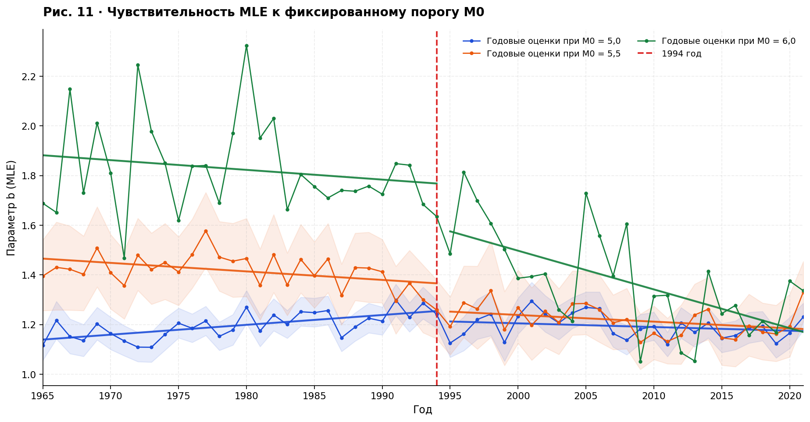

Синие, оранжевые и зелёные ряды соответствуют порогам 5,0; 5,5 и 6,0. Сплошные прямые — кусочно-линейные тренды по обе стороны 1994 года, красный пунктир — дата разделения. Полупрозрачные полосы показаны для порогов 5,0 и 5,5. Значимость проверки сохраняется при всех трёх порогах, хотя величина скачка и неопределённость меняются.
